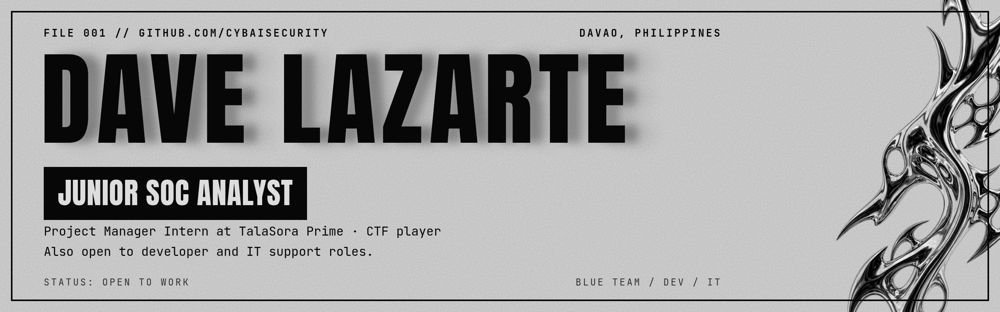

  

  
  
  
  
  

### Hi, I'm Dave

Cybersecurity-focused developer from Davao, Philippines. I lead a 12-person intern team and support the infrastructure at TalaSora Prime, an early-stage venture. Outside work, I compete in CTFs and enjoy exploring new technology.

I'm open to Junior SOC Analyst, developer and IT support roles.

### Now

- **Project Manager Intern, TalaSora Prime** (Sep 2026 to present). I lead a 12-person intern team: tasks, standups and reviews. I also help run Proxmox/KVM, Docker, Cloudflare, DNS, WireGuard, OPNsense and CI/CD.
- **Founder and President, YanoSec** (Aug 2026 to present). A student-driven cybersecurity community where we organise CTF events and learning sessions.
- **Before that:** IT Support and Data Encoder at SABS (Jun 2022 to Aug 2026): Windows recovery, DNS, printer and hardware troubleshooting.

### Highlights

- **TRON Cup 2026 national champion** with Team Zyber, at the Cyber Defense Exercise National Finals run by the Philippine Army.
- **TryHackMe top 5%**, 90+ rooms.

### Stack

<table>
  <tr>
    <td valign="middle"><b>Blue team</b> <code>watch, log, triage</code></td>
    <td>        </td>
  </tr>
  <tr>
    <td valign="middle"><b>Offensive</b> <code>break it first</code></td>
    <td>           </td>
  </tr>
  <tr>
    <td valign="middle"><b>Languages</b> <code>and the frameworks on top</code></td>
    <td>              </td>
  </tr>
  <tr>
    <td valign="middle"><b>Infra</b> <code>keep it running</code></td>
    <td>              </td>
  </tr>
</table>

### Selected work

| Project | What it is | Stack |
| --- | --- | --- |
| [SACRED](https://cybaisec.pages.obsidian-shards.com/Dave-Portfolio/work/sacred/) | Parish records system. I handled backend and QA. | PHP, MongoDB, Docker |
| [Atomic](https://cybaisec.pages.obsidian-shards.com/Dave-Portfolio/work/atomic/) | Home SOC lab on KVM | KVM, Wazuh, Ubuntu |
| [ScanZ](https://cybaisec.pages.obsidian-shards.com/Dave-Portfolio/work/scanz/) | Android network scanner | Kotlin, Android |
| [Pcap-Triage](https://cybaisec.pages.obsidian-shards.com/Dave-Portfolio/work/pcap-triage/) | Packet capture triage CLI | Python, TShark |

Public code: [ScanZ](https://github.com/CyBaiSecurity/ScanZ) · [RootMap](https://github.com/CyBaiSecurity/rootmap) · [Organice](https://github.com/CyBaiSecurity/Organice) · [MusicZ](https://github.com/CyBaiSecurity/MusicZ) · [Vulnsite](https://github.com/CyBaiSecurity/vulnwebsite) · [Pi Learning Lab](https://github.com/CyBaiSecurity/pi-learning-lab)

<code>// more projects, case studies and resumes on the <a href="https://cybaisec.pages.obsidian-shards.com/Dave-Portfolio/">portfolio</a></code>

